# endfield-ui

An agent skill for building UI with an *Arknights: Endfield*-flavoured industrial look — on the web, mobile web, iOS, Android, Flutter, React Native, WeChat mini programs and desktop apps. Uses no game assets.

一个让 AI 写出"终末地风格"界面的 skill：浅色底配黑字，只用一种亮色（默认是黄 `#FFFA00`），能点的按钮切掉一个角，标题上面放一行拉宽的英文小字、下面是粗体中文，列表每一行都有编号，背景只有淡淡的斜线和等高线，动画短而干脆。覆盖网页、手机网页、iOS、Android、Flutter、React Native、小程序和桌面应用。

基本规则每个产品都一样，外观可以按产品换：亮色、底色、切角大小、背景纹理、疏密、动画多少六项都能调，另有四组现成的搭配，免得每个用它的产品都长得一样（见 `references/variation.md`）。

## 安装

这是一个标准的 [Agent Skills](https://agentskills.io) 包（根目录 `SKILL.md`），不绑定某一家的 agent。挑一种装法：

**通用：skills CLI（推荐）**，一条命令装给本机已有的 agent（Claude Code、Codex、Cursor、Gemini CLI、GitHub Copilot 等）：

```sh
npx skills add hhikr/endfield-ui-skill
npx skills add hhikr/endfield-ui-skill -a codex   # 只装给某一个 agent，例如 claude-code / codex / cursor
```

**Claude Code**

```sh
git clone https://github.com/hhikr/endfield-ui-skill ~/.claude/skills/endfield-ui   # 所有项目可用
# 或放进某个项目：<项目>/.claude/skills/endfield-ui/
```

**OpenAI Codex**（CLI、IDE 插件、桌面版）

```sh
git clone https://github.com/hhikr/endfield-ui-skill ~/.agents/skills/endfield-ui   # 所有项目可用
# 或放进某个项目：<项目>/.agents/skills/endfield-ui/
```

装好后重启 Codex；可以直接说"做成终末地风格"，也可以用 `$endfield-ui` 点名调用。`agents/openai.yaml` 提供了 Codex 界面里的名字、简介和颜色。

**其他 agent / 不支持 skills 的工具**（只读 `AGENTS.md`、`.cursorrules`、`GEMINI.md` 这类规则文件的）：把仓库放进项目，例如 `vendor/endfield-ui/`，在规则文件里加一行：

```md
做界面时，先读 vendor/endfield-ui/SKILL.md，按里面的步骤和规则做；需要的文件都在同一目录。
```

**ChatGPT 网页 / 桌面对话**：没有安装目录。可以把 `SKILL.md` 和要用的平台指南（`references/platforms/*.md`）作为附件上传，让它照着做。

## 结构

agent 只在被触发时读 `SKILL.md`；其余文件按需打开，不会一次全塞进上下文。

```text
endfield-ui-skill/
├── SKILL.md                  入口：气质、选页面类型、定变体、选平台、字体、部件速查、规则、交付清单、文件地图
├── agents/openai.yaml        Codex 界面里的名字、简介、颜色（其他 agent 忽略）
├── references/               按需读的细节
│   ├── glossary.md           术语表：内部叫法的意思，以及对人该怎么说
│   ├── research.md           对官网和游戏界面的调研：看到了什么、借什么不借什么
│   ├── tokens.md             色值与对比度、深色主题、字体、字号
│   ├── components.md         每个部件的写法、含义和禁忌（含手机网页部件、表格、柱图）
│   ├── patterns.md           三种页面类型的范式，App 的标签栏、列表、详情、表单、面板、对话框
│   ├── motion.md             动效：原则、三条曲线、编排、完整清单、进出、状态变化、减少动效
│   ├── variation.md          变体：不能变的固定规则、六个可变维度、四组预设、不照抄模板、新部件怎么推
│   ├── rules.md              做与不做，每条的理由
│   └── platforms/            web / mobile-web / ios / android / flutter / cross-platform / miniprogram
├── assets/                   可直接拷进项目的东西
│   ├── tokens.json           平台无关的 token：颜色、字体、字号、间距、切角、线宽、动效、变体
│   ├── endfield.css          网页套件：全部变量和 ef- 部件，不依赖框架
│   ├── fx.js                 乱码后落定、深浅切换、视差、面板与对话框进出、提示条、删行、完成反馈
│   ├── dial.js               控制台的分段圆盘
│   ├── variant.js            开页前按地址或 data-ef-* 设好变体
│   └── contours/             背景等高线 SVG 和生成脚本
├── templates/                可运行的参考实现
│   ├── showcase.html         页面类型一：展示页（字标、三色条、索引）
│   ├── reading.html          页面类型二：阅读页（长文、目录、相关记录）
│   ├── console.html          页面类型三：控制台（看板、圆盘、读数）
│   ├── app.html              手机网页（H5 / PWA）：列表、设置、状态、底部面板、对话框
│   ├── motion.html           动效样张：每个动效一格，可重放
│   ├── specimen.html         全部网页部件的样张
│   ├── antipatterns.html     做与不做的对照页
│   └── flutter/              Flutter 套件（lib/ef/）和六个示例屏幕
└── examples/                 截图，不用跑就能看
    ├── web/                  各网页模板的浅色、深色、手机宽度截图
    ├── app/                  Flutter 示例屏幕（390×844，浅、深），overview-*.jpg 是六屏总览
    └── motion/               录屏 GIF：App 和整页操作；each/ 里每个动效各一段
```

agent 的工作顺序：读 `SKILL.md` → 读 `references/variation.md` 定变体和主视觉 → 按页面类型和平台打开对应的 `references/platforms/*.md` → 网页直接引用 `assets/`，Flutter 拷 `templates/flutter/lib/ef/`，其他平台照 `tokens.json` 和平台指南自己落地 → 用 `SKILL.md` 末尾的清单自查。

## 预览

不想起服务器的话，先看下面的截图和录屏。录屏都是从模板实际跑出来的，速度就是真实速度；GIF 的帧率较低（20–30 帧/秒），颜色也压缩过，曲线的手感以浏览器里跑的为准。

### 用起来什么样

截图：`examples/web/`（网页模板的浅、深、手机宽度）和 `examples/app/`（Flutter 六个屏幕）。

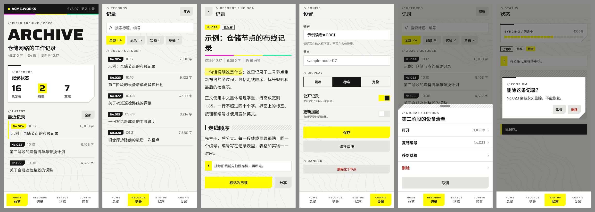

真实操作一遍的录屏（`examples/motion/`）：

| 手机网页：列表与底部面板 | 设置与对话框 | 状态 |
| --- | --- | --- |
| 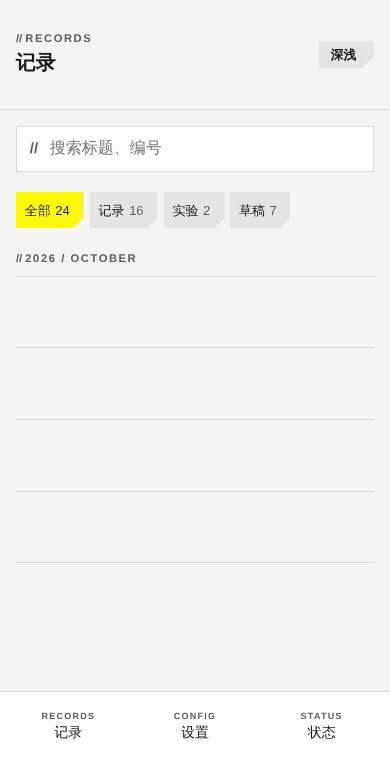 | 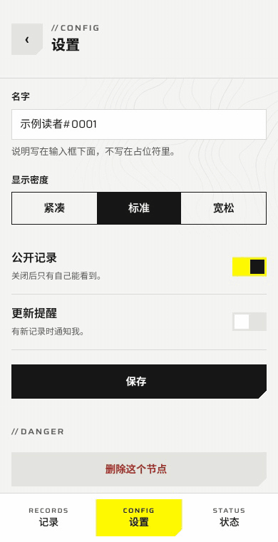 | 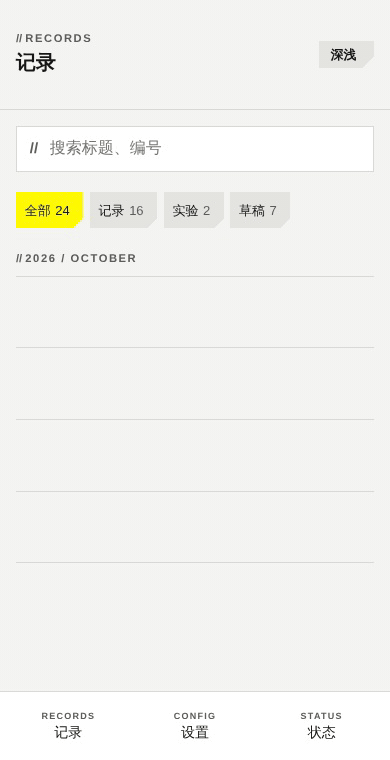 |
| 列表逐行亮起，点一行推入底部面板，取消后推回 | 开关和分段移动，保存的处理中到完成，删除确认对话框的通电和关上 | 删除一行后下面的行补位，提示条擦入再擦掉 |

| 展示页打开 | 控制台打开 |
| --- | --- |
| 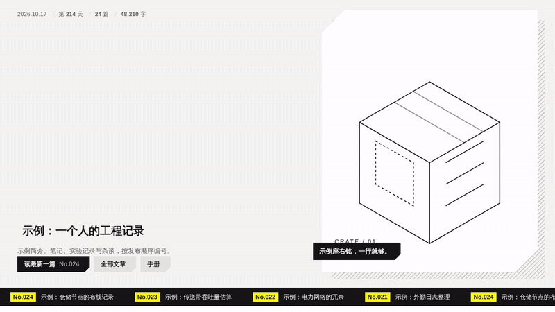 | 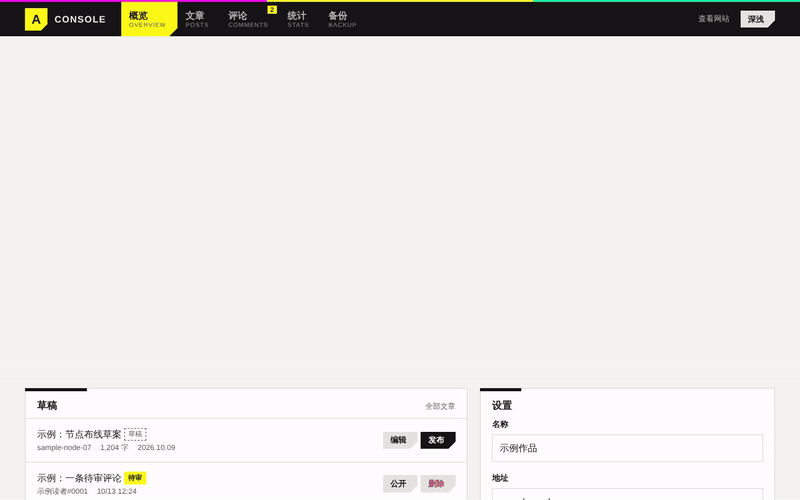 |
| 三色条扫过、字标推入、马克笔划过、读数落定；底部滚动条一直走；然后是指针视差 | 圆盘组装、看板通电、大数字落定；然后悬停圆盘的段：括住、光束连到中心、读数换成该段 |

| 深浅切换 | 换页 |
| --- | --- |
| 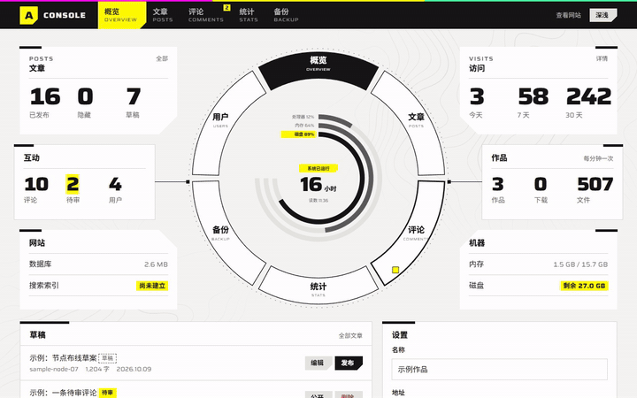 | 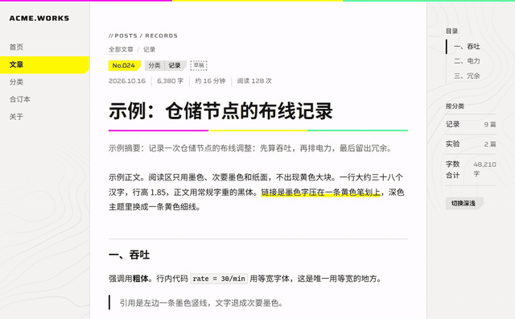 |
| 从按钮处扩散一个圆揭开新主题 | 阅读页 → 控制台 → 阅读页：同源跳转时的快门（`@view-transition`） |

### 同一套规则，四种外观

同一个页面，从左到右是四组预设：`standard` 标准、`coldstore` 冷库（冰蓝、冷灰纸、小切角、网格底纹、去掉入场动效）、`site` 工地（琥珀、米色纸、大切角、斜线纹底纹）、`nightshift` 夜班（荧光绿、默认深色、无底纹、紧凑）。编号、切角、宽体字段、细线这些固定规则没变，强调色、纸色、切角大小、底纹和密度变了。

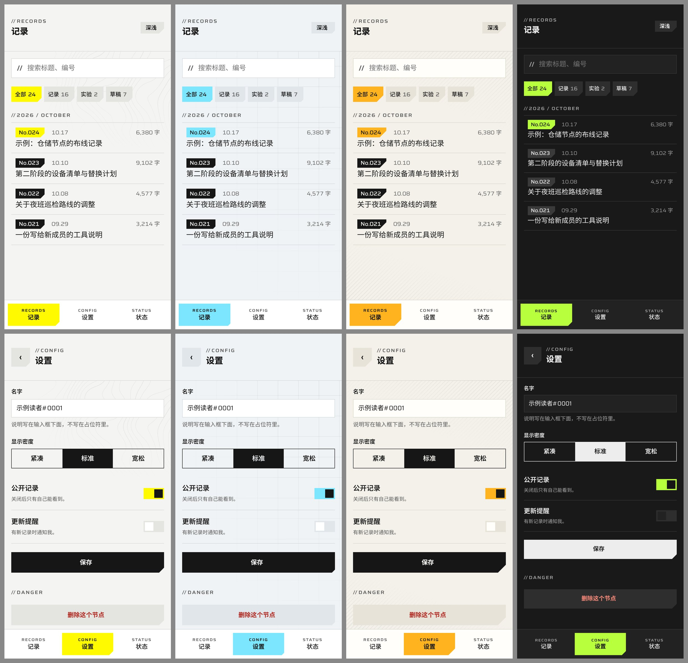

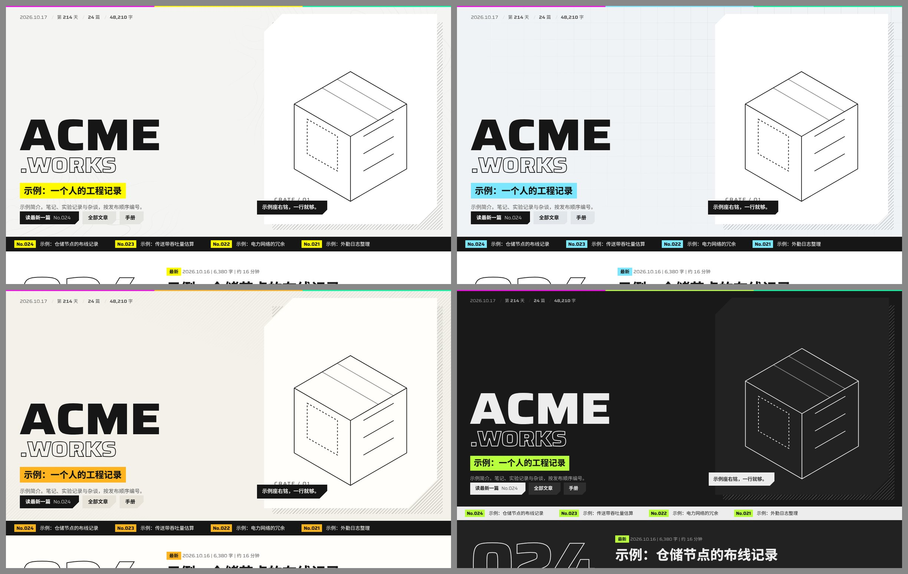

六个维度怎么选、自定义强调色要满足什么对比度、怎么写变体卡，见 `references/variation.md`。

### 每个动效

`references/motion.md` 动效清单里的每一项各有一段录屏（`examples/motion/each/`，从 `templates/motion.html` 对应的那一格录下）。说明格式是“触发 │ 时长（毫秒） │ 曲线”。

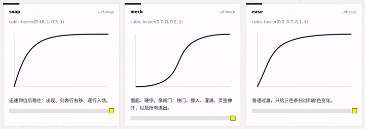

**三条曲线**：`snap` 迅速到位后稳住，`mech` 慢起硬停，`ease` 只给三色条和颜色变化。

**打开页面**

<table>
<tr>
<td width="33%" valign="top"><b>三色条扫过</b><br><sub>一次访问的第一页 │ 600 │ ease</sub><br>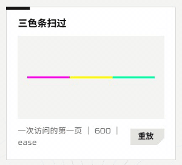</td>
<td width="33%" valign="top"><b>字标推入</b><br><sub>展示页 │ 620，第二行晚 140 │ mech</sub><br>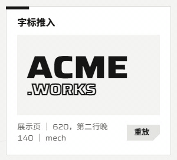</td>
<td width="33%" valign="top"><b>马克笔划过</b><br><sub>展示页 │ 晚 420，420 │ mech</sub><br>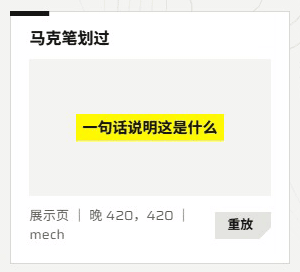</td>
</tr>
<tr>
<td valign="top"><b>乱码后落定</b><br><sub>打开页面 │ 600，每个晚 ≤ 40 │ 线性</sub><br>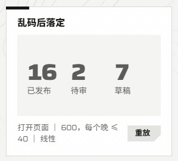</td>
<td valign="top"><b>通电</b><br><sub>打开控制台 │ 520，每行晚 100 │ mech</sub><br>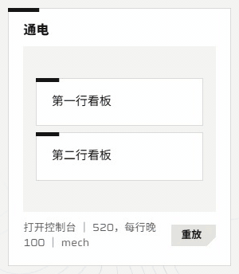</td>
<td valign="top"><b>逐行亮起</b><br><sub>切换列表内容 │ 320，每行晚 38 │ snap</sub><br>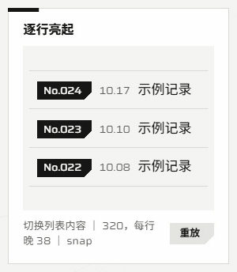</td>
</tr>
<tr>
<td valign="top"><b>圆盘组装</b><br><sub>打开控制台 │ 360，每段晚 45 │ snap</sub><br>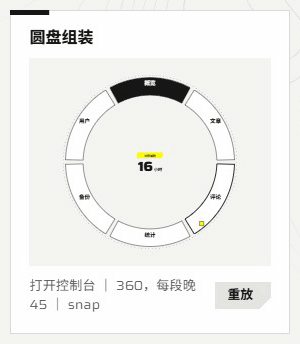</td>
<td></td>
<td></td>
</tr>
</table>

**回应操作**

<table>
<tr>
<td width="33%" valign="top"><b>黄色擦入、亮边扫过、按下</b><br><sub>悬停 / 聚焦 │ 280 │ mech；按下 100</sub><br>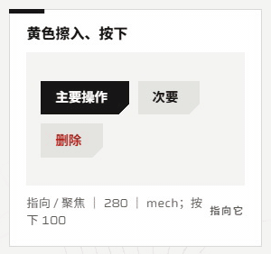</td>
<td width="33%" valign="top"><b>色条落下、整行右移</b><br><sub>悬停 / 按下 │ 200，右移 250 │ snap</sub><br>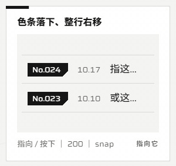</td>
<td width="33%" valign="top"><b>页签伸开</b><br><sub>悬停看板 │ 400 │ mech</sub><br>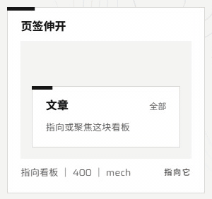</td>
</tr>
<tr>
<td valign="top"><b>墨色灌满</b>（数字同时乱码落定）<br><sub>悬停空心大编号 │ 450 │ mech</sub><br>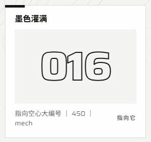</td>
<td valign="top"><b>保存：处理中，然后完成</b><br><sub>aria-busy → 完成一次擦过 600 │ mech</sub><br>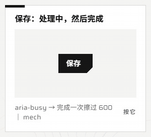</td>
<td valign="top"><b>分段进度</b><br><sub>按格跳，不平滑；未知进度循环，完成即停</sub><br>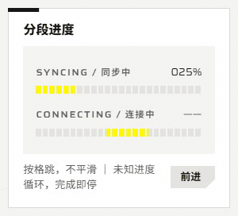</td>
</tr>
<tr>
<td colspan="3" valign="top"><b>锁定、黄底灌满</b>（控制台）<br><sub>悬停圆盘某段：括住、光束连到中心、读数换成该段 300 │ mech；悬停看板里的大数字：黄底灌满 220 │ mech</sub><br>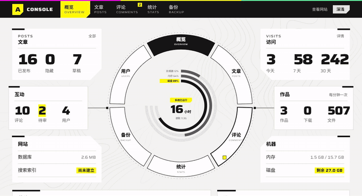</td>
</tr>
</table>

**进出与状态变化**

<table>
<tr>
<td width="33%" valign="top"><b>提示擦入</b><br><sub>出错 / 需要注意 │ 280 │ mech；不抖动</sub><br>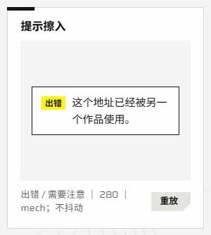</td>
<td width="33%" valign="top"><b>删除一行</b><br><sub>向右擦掉 200 │ mech；下面的行上移 200 │ snap</sub><br>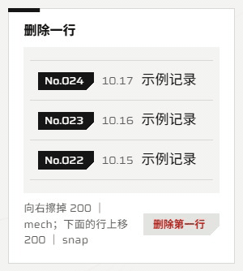</td>
<td width="33%" valign="top"><b>提示条</b><br><sub>从左擦入 280，停 2 秒，向右擦掉 160 │ mech</sub><br>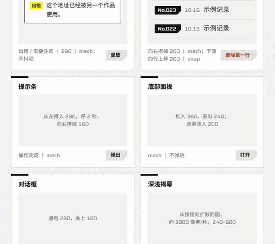</td>
</tr>
<tr>
<td valign="top"><b>底部面板</b><br><sub>推入 360，退出 240，遮罩淡入 200 │ mech；不弹跳</sub><br>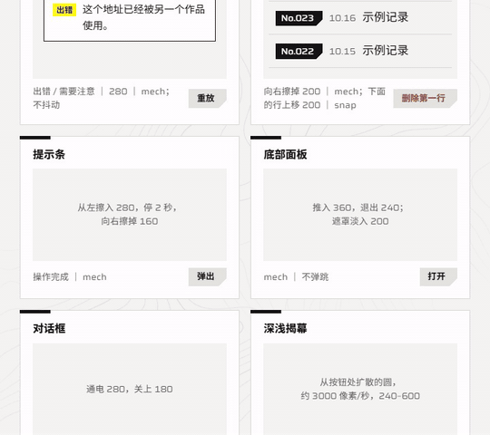</td>
<td valign="top"><b>对话框</b><br><sub>通电 280，关上 180 │ mech</sub><br>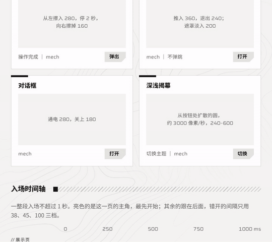</td>
<td valign="top"><b>深浅揭幕</b>、<b>换页快门</b><br><sub>见上面“用起来什么样”里的两段录屏</sub></td>
</tr>
</table>

清单里剩下的**指针视差**和**滚动条**在上面“展示页打开”那段录屏里。

### 在浏览器里跑网页模板

模板用了 ES module，浏览器不允许从 `file://` 加载，所以要在**仓库根目录**起一个静态服务器（不要在 `templates/` 里起，模板要引用上一级的 `assets/`）：

```sh
npx http-server -p 8766          # 有 Node 就用这个
python3 -m http.server 8766      # 或者 Python；Windows 上用 py -m http.server 8766
```

> Windows 上如果 `python` 敲下去什么都没发生，那是应用商店的占位程序，并没有装 Python，换用上面的 `npx` 或 `py`。端口被占用时（打开后看到的不是模板，比如只有 `{}`），换一个端口号。

然后打开：

| 地址 | 看什么 |
| --- | --- |
| `http://localhost:8766/templates/motion.html` | 动效样张，见下一节 |
| `http://localhost:8766/templates/showcase.html` | 展示页：三色条扫过、字标推入、马克笔划过、指针视差 |
| `http://localhost:8766/templates/console.html` | 控制台：看板通电、圆盘组装、读数乱码落定、悬停圆盘锁定 |
| `http://localhost:8766/templates/reading.html` | 阅读页 |
| `http://localhost:8766/templates/app.html` | 手机网页。用浏览器的设备模式（F12 → 切换设备工具栏）调到 360–430 宽 |
| `http://localhost:8766/templates/specimen.html` | 全部部件，hover 状态也摆出来了 |
| `http://localhost:8766/templates/antipatterns.html` | 反例和正例并排 |

每页都有深浅切换按钮。所有模板都认这些地址参数：

- `?variant=standard|coldstore|site|nightshift`：套用一组预设
- `?accent=yellow|lime|ice|amber`、`&paper=neutral|warm|cool`、`&cut=tight|standard|wide`、`&ground=contours|grid|hatch|plain`、`&density=compact|standard|roomy`、`&motion=full|calm`：单独换某一项，可以和 `variant` 一起用

`app.html` 和 `motion.html` 还认：

- `?theme=light` / `?theme=dark`：指定深浅
- `app.html?screen=list|settings|states`：直接打开某个标签页；加 `&sheet=1` 或 `&dialog=1` 打开底部面板或对话框

### 动效参考：`templates/motion.html`

所有动效都在这一页，按 `references/motion.md` 的清单排列，每格下面写着“触发 │ 时长 │ 曲线”：

- **三条曲线**：`snap`、`mech`、`ease` 的形状和用途
- **打开页面**：三色条扫过、字标推入、马克笔划过、乱码后落定、通电、逐行亮起、圆盘组装 —— 每格有“重放”
- **回应操作**：按钮黄色擦入与按下、列表行色条落下并右移、看板页签伸开、空心大编号墨色灌满、保存的处理中到完成、分段进度（“前进”一格一格跳）—— 用鼠标悬停或按 Tab 聚焦来触发
- **进出与状态变化**：提示擦入、删除一行、提示条、底部面板、对话框、深浅揭幕 —— 点各格的按钮触发
- **入场时间轴**：一个页面的整段入场怎么错开，全程不超过 1 秒

顶部“全部重放”一次把入场动效全播一遍。

如果一格都不动：系统开了“减少动态效果”（Windows：设置 → 辅助功能 → 视觉效果 → 动画效果；macOS：辅助功能 → 显示 → 减弱动态效果），页面顶部会出现提示 —— 这是期望的行为，所有动效在这个设置下都会直接跳到结束。想临时看效果，可以在 Chrome 开发者工具的 Rendering 面板里把 `prefers-reduced-motion` 模拟成 `no-preference`。

想看清曲线和先后顺序，可以在开发者工具的 Animations 面板里把播放速度调到 25% 或 10%。

动效的具体数值（时长、曲线、错开间隔）在 `references/motion.md` 和 `assets/tokens.json` 的 `motion` 里；各平台怎么对应写在该文档的“手机上的对应”一节。

### 跑 Flutter 示例

`templates/flutter/` 只带了 `lib/`、`test/` 和字体，没有 `android/`、`ios/`、`web/` 这些平台目录，直接 `flutter run` 会失败，要先生成一次：

```sh
cp -r templates/flutter my_app && cd my_app
flutter create .   # 生成平台目录，不覆盖已有的 lib/ 和 test/
flutter run        # 任选一个设备；flutter run -d chrome 也行
```

底部标签栏是总览、记录、状态、设置四项；在记录里点一行进详情，点“筛选”拉出底部面板，设置页里能切换深浅（默认跟随系统）。用 `-d chrome` 跑时同样认 `?theme=dark` 和 `?screen=home|list|detail|settings|sheet|states`（状态页再加 `&dialog=1` 打开对话框），以及 `&accent=lime|ice|amber` 换强调色。在自己的项目里换强调色，把 `EfAccent` 里的一种（或自己的颜色）传给 `efTheme(…, accent:)`。`flutter test` 会跑一遍 widget 测试。

## 许可

`templates/flutter/fonts/Saira.ttf` 是 [Saira](https://github.com/Omnibus-Type/Saira)，SIL Open Font License 1.1（见同目录 `Saira-OFL.txt`）。示例中的名字和数字都是虚构的。本项目与游戏及其开发商无关，不包含任何官方素材。
